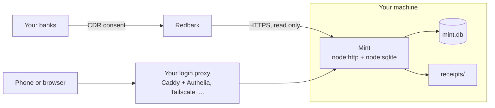

<p align="center">
  
</p>

<p align="center">
  <b>Pay-cycle budgets, CDR bank feeds and ATO tax tagging, in one SQLite file you own.</b><br>
  No cloud, no account, no npm dependencies, no build step.
</p>

<p align="center">
  <a href="LICENSE"></a>
  
  
  <a href="https://github.com/kd-011/mint/actions/workflows/ci.yml"></a>
  
</p>

<p align="center">
  
</p>

<p align="center">
  
</p>

Every figure and name in these images comes from the made-up demo data in `scripts/demo-seed.mjs`. No real account was used.

## Why Mint

Most budgeting apps assume a US bank, a calendar month and someone else's server. Mint is built around how an Australian actually gets paid and taxed:

- **It reads Australian banks.** Bank feeds come through [Redbark](https://redbark.com), a commercial aggregator that uses the Consumer Data Right (CDR). Mint keeps its own full copy of the history.
- **Budgets follow your pay, not the calendar.** A cycle runs from one salary deposit to the day before the next. Mint finds your salary, learns the rhythm and predicts the next payday.
- **One number: safe to spend.** Expected pay, less your savings split and fixed bills, less what you have spent so far, divided by the days left until payday.
- **Tax time is already half done.** Tag a transaction as an ATO deduction, attach a receipt photo, export a financial year summary or an accountant pack.
- **Your data is a file.** One SQLite database and a folder of receipts, on a machine you control. Back it up with one script.

Mint plans, checks and nudges. It never moves money: its Redbark client only reads.

## Try it in 30 seconds

You need Node 22 or newer. There is nothing to install.

```sh
git clone https://github.com/kd-011/mint.git
cd mint
node scripts/demo-seed.mjs
```

Open <http://127.0.0.1:8980/>. This starts a fake Redbark, a throwaway database and the real server, loads a year of invented transactions, budgets, goals, shares and a home loan, and deletes it all when you press Ctrl-C. No Redbark key needed.

With Docker instead:

```sh
docker compose up
```

Then open <http://127.0.0.1:8980/> (use `127.0.0.1`, not `localhost`). Details, and how to run your own book in a container, are in [docs/self-hosting.md](docs/self-hosting.md).

## What it does

**Money plan**
- Pay cycles and per-cycle budgets with rollover, found from your salary deposits
- Safe to spend until payday, with a cash check against bills still due
- A pay split plan (what each payday should send where) and a check that it happened
- Savings goals with a monthly pace, and a view of debt, offset and a home loan

<p>
  
  
  
  
</p>

**Banks and balances**
- Every account Redbark can see, plus accounts it cannot, entered by hand in any currency with CSV statement import
- Net worth across cash, cards, loans, shares, property and super; live ASX and US share prices
- Transfers between your own accounts are matched so they do not count as spending, and card and loan repayments are recognised
- Wise balances (optional)

**Spending**
- Search across everything, saved views, filters, merchant rules and an optional model pass for merchants it cannot place
- Subscriptions and bills detected from the history, with price rise and unusual charge alerts
- A "what changed this pay cycle" digest

**Tax**
- ATO deduction tags, business spend, receipt photos, financial year export and an accountant pack
- Income checked against your Notices of Assessment, and a return estimate. It is bookkeeping, not advice.

**Running it**
- A progressive web app: install it to your phone, works offline for reads, queues edits
- A passkey fingerprint lock on top of your own login gateway
- Encrypted off-box backups with a restore test
- An optional Android shell (`android-shell/`) you build and sign yourself

## How it fits together



One Node process serves the API and a plain JavaScript single page app. It polls Redbark every 30 minutes and reconciles nightly. There is no queue, no cache server and no second database.

## Mint compared with other budgeting apps

All three are good software with larger communities than Mint. This table lists only differences that could be checked against each project's own docs and issue tracker on 2026-11-01. "Not documented" means it was not found on the pages linked, not that it is absent.

| | Mint | Actual Budget | Firefly III | Lunch Money |
| --- | --- | --- | --- | --- |
| Where it runs | Your machine | Your machine ([docs](https://actualbudget.org/docs/install/)) | Your machine ([repo](https://github.com/firefly-iii/firefly-iii)) | Hosted subscription; no self-hosting documented |
| Licence | AGPL-3.0 | MIT | AGPL-3.0 | Not stated on the pages I read |
| Stack to run | Node 22, nothing else | Node or Docker | PHP and Laravel, plus a database | Not applicable |
| Australian CDR bank feed | Yes, through Redbark (paid) | Not in its [bank sync docs](https://actualbudget.org/docs/advanced/bank-sync/) (Redbark [documents a SimpleFIN route](https://redbark.com/docs/actual-budget.md)) | Not in its importer docs (Redbark [documents a SimpleFIN route](https://redbark.com/docs/firefly-iii.md)) | Not implemented, per a [staff reply](https://feedback.lunchmoney.app/institution-status-requests/p/bank-import-australia) in June 2026 |
| Budget periods that follow pay | Yes, found from your salary | Monthly in its [budgeting docs](https://actualbudget.org/docs/budgeting/) | No: the maintainer [says custom cycles will not happen](https://github.com/firefly-iii/firefly-iii/discussions/8902) | Yes, a [custom period](https://support.lunchmoney.app/guides/budgeting/step-2-setting-up-your-budget) from a start date |
| ATO tax tags and accountant pack | Yes | Not documented | Not documented | Not documented |

What the others do that Mint does not: more than one user, many countries, mature envelope budgeting (Actual), double-entry accounting (Firefly III), a hosted service nobody has to run (Lunch Money), and years of other people's bug reports.

## Setup for your own book

Mint needs a Redbark account with API access, and a reverse proxy that logs you in. Both are covered step by step:

- [docs/redbark-setup.md](docs/redbark-setup.md): get an API key and connect your banks
- [docs/self-hosting.md](docs/self-hosting.md): the login gateway, Caddy with Authelia, Tailscale, Cloudflare, Docker, systemd

The short version:

```sh
cp .env.example .env
chmod 600 .env
# fill in REDBARK_API_KEY, MINT_GATE_KEY (openssl rand -hex 32), MINT_USER and MINT_ORIGIN
node server.mjs
```

Mint listens on `127.0.0.1:8970` only. The first start backfills each account (up to about seven years where the bank allows), then polls every 30 minutes with a full reconcile at 02:40 Perth time. It will not answer anyone who does not arrive through your login gateway, so read the self-hosting page before you open it in a browser.

### Configuration

Everything is an environment variable, read from `.env` next to `server.mjs` or from the real environment. `.env.example` lists every one with a comment. The ones you will touch:

| Variable | What it does |
| --- | --- |
| `REDBARK_API_KEY` | Required. Your Redbark key. |
| `MINT_GATE_KEY` | Required. Shared secret your proxy sends as `X-Mint-Gate` (32+ characters). |
| `MINT_USER` | Login name your proxy sends as `Remote-User`. Default `owner`. |
| `MINT_ORIGIN` | The https origin you serve Mint from. Default `http://localhost:<port>`. |
| `MINT_PORT` | Listen port on 127.0.0.1. Default 8970. |
| `MINT_HOME` | Folder for `data/`, `backups/` and `.env`. Default: the code folder. |
| `MINT_LOCK` | `off` disables the fingerprint lock, until a fingerprint is enrolled. |
| `OPENROUTER_API_KEY` | Optional. Lets a model categorise merchants Mint cannot place. See the FAQ for what is sent. |
| `WISE_API_TOKEN`, `ALPHAVANTAGE_API_KEY` | Optional. Wise balances, US share prices. |
| `MINT_BACKUP_*` | Optional. Encrypted off-box backups. |

### Backup and restore

Your data is `data/mint.db` plus `data/receipts/`.

- `node scripts/backup.mjs` writes a consistent snapshot to `backups/mint-<date>.db` and keeps the newest 14. Run it daily from cron or a systemd timer.
- Set `MINT_BACKUP_HOST` (an ssh host from `~/.ssh/config`) and `MINT_BACKUP_AGE_RECIPIENT` (an [age](https://age-encryption.org) public key) and the same script also copies a gzipped, age-encrypted snapshot and an encrypted receipts mirror there. Keep the private key off the same disk.
- `node scripts/restore-test.mjs` pulls the newest off-box copy, decrypts it, checks integrity and compares row counts. A backup you have never restored is a hope.
- To restore: stop Mint, copy a snapshot over `data/mint.db`, delete any `mint.db-wal` and `mint.db-shm` beside it, start Mint. If you lose your phone or passkey, `node scripts/lock-reset.mjs --yes` clears the enrolled fingerprints.

## Security

- **Single user.** One owner, no roles. Do not share it.
- **It holds your bank data.** Treat the machine, `data/` and every backup as sensitive.
- **Two locks.** Your gateway headers (`Remote-User` and the `X-Mint-Gate` secret) are the first, the passkey is the second. Never expose port 8970 directly.
- Secrets live in `.env` (mode 600, never committed). `scripts/secret-scan.mjs` and CI keep keys and personal data out of the repository.
- Found a vulnerability? Use a private advisory, see [SECURITY.md](SECURITY.md). Please never post real data in an issue.

## FAQ

**Is it safe to point at my bank data?** It is as safe as the machine and the login in front of it. Mint binds to loopback, refuses requests that did not come through your gateway, and adds a passkey lock. It has no accounts, no telemetry and no callbacks to its author. It is young software: read [SECURITY.md](SECURITY.md) and decide.

**Where does my data go?** Your transactions go from your banks to Redbark to your machine, and stay there. Mint's own outbound calls are: Redbark (the bank feed); merchant icons, fetched by the server from Google or DuckDuckGo by website domain only (no amounts, no account data); Frankfurter for exchange rates and Yahoo or Alpha Vantage for share prices, if you hold foreign currency or shares; and OpenRouter and Wise, only if you set their keys. The browser only talks to your own Mint (a strict content security policy enforces it). Setting `MINT_SCHEDULER=off` stops the scheduled bank polling and the background icon and price fetches.

**What does the AI categoriser send?** Nothing unless you set `OPENROUTER_API_KEY`. With a key, unknown merchants are sent for one batched question: the merchant name and bank description, with digit runs, card masks and dollar amounts stripped first (`scrubForModel` in `lib/categorise.mjs`). Never balances, account numbers or full histories. A daily cap applies. The same key is used to ask for a merchant's website when the built-in map has none.

**Does it move money?** No. The Redbark client only reads. Mint checks whether the transfers you made match your plan; it cannot make them.

**Does it work outside Australia?** The feed is Australian (CDR). You can run it on manual accounts and CSV imports anywhere, but schedules and day boundaries are fixed to Perth time and the tax parts are ATO only.

**Is Redbark free?** No. It is a separate commercial service with its own terms. At the time of writing, API access needs a paid plan after a short trial; see [docs/redbark-setup.md](docs/redbark-setup.md) for what was verified and when. Mint has no financial interest in it.

## Roadmap and known limits

Honest list, roughly in order of how much it matters:

- **Perth time only.** Day boundaries and schedules are fixed in `lib/dates.mjs`. Other zones need a small code change.
- **Single user.** One person, one book. There are no shared budgets or roles and none are planned.
- **Redbark is required for live bank feeds**, and it is a paid third party. Manual accounts and CSV import work without it.
- **CDR consent lapses after 12 months** and has to be renewed inside Redbark. Mint warns you before it does.
- **No store listing for the Android app.** You build and sign the shell yourself.
- **Young code.** It runs the maintainer's own finances, but few other people have used it. Expect rough edges and read the diff before upgrading.

Not planned: moving money, budgets shared between people, a hosted version.

## Tests

```sh
node --check *.mjs lib/*.mjs && node --test test/
node scripts/secret-scan.mjs . --tracked
```

Tests run against a fake Redbark over invented fixtures (`test/fixtures/`) and need no network. [docs/reference.md](docs/reference.md) holds the engineering notes: the engine, every API route and the design system. [docs/README.md](docs/README.md) is the index of everything under `docs/`.

## Contributing

Small, focused changes are welcome. Read [CONTRIBUTING.md](CONTRIBUTING.md): sign off your commits (DCO, `git commit -s`), there is no CLA, and never put real financial data in a test, an issue or a screenshot. Everyone taking part follows the [code of conduct](CODE_OF_CONDUCT.md).

## Not financial or tax advice

Mint is a bookkeeping tool. Its budgets, forecasts, tax tags and tax estimates are arithmetic over the data you give it and may be wrong or out of date. Nothing in it is financial, tax, legal or accounting advice. Check figures against your bank, the ATO and a registered tax agent before you rely on them. The software comes with no warranty (see the licence).

## Licence

Copyright (C) 2026 kd-011 and Mint contributors.

Mint is free software under the **GNU Affero General Public License, version 3** (AGPL-3.0). See [LICENSE](LICENSE). If you run a modified Mint for other people over a network, the AGPL requires you to offer them your source. Third-party components and their licences are listed in [THIRD_PARTY_NOTICES.md](THIRD_PARTY_NOTICES.md).
