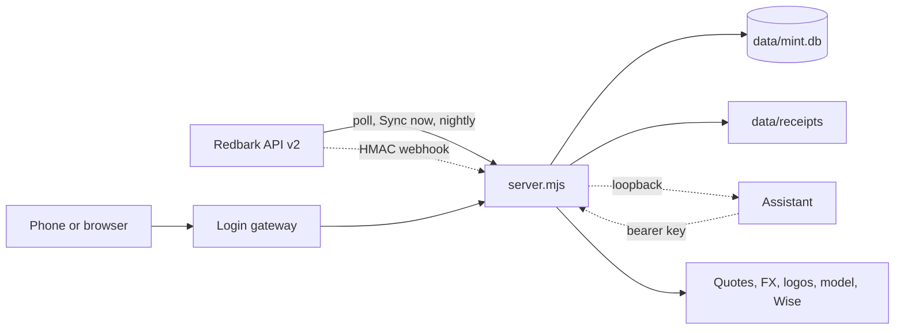

# Mint: how it is built

One zero-dependency Node 22 process (`node:http` and `node:sqlite`) serves a JSON API and a plain-JavaScript single page app over one SQLite file. It sits behind the owner's own login gateway, polls a bank feed on a timer, and runs a categorise, match and plan engine over what it holds. This page is the map; each topic has a file under `docs/architecture/`. <!-- src: server.mjs:1-8, server.mjs:147-191 -->

## Components

- `server.mjs`: the HTTP server, the gate and lock checks, static files, route dispatch and the scheduler. <!-- src: server.mjs:1-8, server.mjs:495-535, server.mjs:537-591 -->
- `lib/db.mjs`: the schema, additive migrations, `openDb` (WAL, foreign keys on) and the `tx` helper that nests as savepoints. <!-- src: lib/db.mjs:6-8, lib/db.mjs:383-385, lib/db.mjs:616-640 -->
- Ingest: `lib/redbark.mjs` (read-only API client), `lib/ingest.mjs` (sync into the book), `lib/webhook.mjs` (signed delivery receiver), `lib/schedule.mjs` (what is due now). See architecture/ingest.md. <!-- src: lib/redbark.mjs:1-4, lib/ingest.mjs:1-3, lib/webhook.mjs:1-8, lib/schedule.mjs:1-5 -->
- Engine: `lib/engine.mjs` runs categorising, transfer matching, income, budgets seeds, alerts and the model pass after every sync. See architecture/engine.md. <!-- src: lib/engine.mjs:1-6 -->
- Money plan: pay cycles, income streams, cycle budgets, safe to spend, the pay split, goals, debt, forecast, net worth, holdings, the Ledger and tax. See architecture/money-plan.md. <!-- src: lib/cycles.mjs:1-5, lib/income.mjs:1-6, lib/budgets.mjs:1-4, lib/safe.mjs:1-5, lib/plan.mjs:1-5, lib/goals.mjs:1-4, lib/debt.mjs:1-5, lib/forecast.mjs:1-4, lib/networth.mjs:1-5, lib/holdings.mjs:1-4, lib/owed.mjs:1-4, lib/tax.mjs:1-5 -->
- Manual accounts, CSV import, Wise and exchange rates: `lib/manual.mjs`, `lib/csvimport.mjs`, `lib/wisesync.mjs`, `lib/fx.mjs`. See architecture/manual-accounts.md. <!-- src: lib/manual.mjs:1-5, lib/csvimport.mjs:1-6, lib/wisesync.mjs:1-4, lib/fx.mjs:1-4 -->
- `lib/api.mjs`: the engine's JSON API under `/api/`, one function that answers `true` when it handled the request. <!-- src: lib/api.mjs:1-2, server.mjs:483-486 -->
- `lib/assistant.mjs`, `lib/chatwrites.mjs`, `lib/undo.mjs`, `lib/chatproxy.mjs`, `lib/chatturn.mjs`: the narrow door an outside assistant uses, and the in-app chat's server half. See architecture/access.md. <!-- src: lib/assistant.mjs:1-10, lib/chatproxy.mjs:1-5 -->
- `lib/lock.mjs`: the fingerprint (passkey) lock. See architecture/access.md. <!-- src: lib/lock.mjs:1-3 -->
- `public/`: the single page app, its service worker and the vendored UI kit in `public/kit/`. See architecture/frontend.md. <!-- src: server.mjs:221-248, public/routes.js:1-5 -->
- `scripts/`: operator and dev tools (demo, local mode, backup, restore test, account merge, lock reset, export, asset generation). See architecture/running.md. <!-- src: scripts/demo-seed.mjs:1-4, scripts/backup.mjs:1-2 -->
- `android-shell/`: an optional Capacitor 8 WebView shell over the same server. <!-- src: android-shell/README.md:3 -->

## Data flow

- A sync (poll, reconcile, Sync now, or a webhook-triggered poll) refreshes connections, accounts and balances, then walks each account's transactions into the book. After it, the engine runs, in the order its header gives. <!-- src: lib/ingest.mjs:1-3, lib/ingest.mjs:253-258, lib/engine.mjs:1-6 -->
- Webhook deliveries and Sync now share one queue in `server.mjs`: a request while a sync runs folds into one follow-up run, debounced 15 seconds. <!-- src: server.mjs:194-219 -->
- The page reads and writes through `/api/*`. Writes are queued in the browser when offline and flushed in order. <!-- src: public/core.js:368-376 -->
- Every `/api/` request passes the gate checks in `server.mjs`, then the lock check, then `route`: lock routes, accounts, sync, chat, `/api/assistant/`, then `lib/api.mjs`. Non-API GETs get the page shell, 200 for a known tab path and 404 otherwise. <!-- src: server.mjs:495-535, server.mjs:406-493 -->
- The assistant calls `/api/assistant/` with a bearer key from the same machine. Reads answer directly; safe writes apply with an undo token; larger ones wait for a confirm token that only the signed-in page can spend. <!-- src: lib/assistant.mjs:1-10, lib/chatwrites.mjs:1-13, server.mjs:500-518 -->

## Storage

- One SQLite database, `data/mint.db` under `MINT_HOME`, mode 600, in WAL mode. Money is integer cents, dates are `YYYY-MM-DD` in the `MINT_TZ` zone, timestamps are UTC ISO. Redbark keeps no history, so this file is the only full copy. <!-- src: server.mjs:113-117, lib/db.mjs:1-4, lib/db.mjs:616-619 -->
- Tables, grouped: sync and accounts (`connections`, `accounts`, `balance_snapshots`, `sync_log`, `webhook_deliveries`, `account_merges`); transactions and categorising (`transactions`, `categories`, `rules`, `transfers`, `transfer_rejections`, `ai_cache`, `ai_usage`, `merchant_logo`, `saved_views`); money plan (`income_sources`, `budgets`, `pay_plan`, `goals`, `goal_contributions`, `subscriptions`, `loan_inputs`, `alerts`); wealth (`manual_assets`, `manual_snapshots`, `manual_imports`, `holdings`, `holding_lots`, `quotes`, `fx_rates`, `portfolio_snapshots`, `owed`, `owed_payments`); tax (`tax_tags`, `receipts`, `tax_assessments`); the assistant door (`undo_log`, `confirm_tokens`, `chat_turn_writes`); the lock (`lock_credentials`, `lock_sessions`); `settings` (key and value). <!-- src: lib/db.mjs:6-610 -->
- Receipts are files under `data/receipts`, not rows. <!-- src: lib/tax.mjs:1-5 -->
- Backups: `scripts/backup.mjs` writes a `VACUUM INTO` snapshot to `backups/` (newest 14 kept) and, when configured, an age-encrypted copy to an ssh host plus an encrypted receipts mirror. See architecture/running.md. <!-- src: scripts/backup.mjs:1-10 -->
- In the browser: reads cached in `localStorage` under `mint:` keys, queued writes in `localStorage`, queued receipt photos in IndexedDB, and the app shell plus merchant logos in two service worker caches. <!-- src: public/core.js:212-220, public/core.js:368-370, public/core.js:432-437, public/sw.js:5-10 -->

## Auth

- Two locks. First, the owner's login gateway must send `Remote-User` equal to `MINT_USER` and the shared secret `MINT_GATE_KEY` as `X-Mint-Gate`; anything else is 401. Second, the fingerprint lock: with the lock on, every `/api/` route except the lock's own answers 423 until a passkey assertion opens a session. <!-- src: server.mjs:1-8, server.mjs:519-527 -->
- Open without the gate identity: the PWA install assets, `/healthz`, `/.well-known/assetlinks.json` and the HMAC-signed Redbark webhook. <!-- src: server.mjs:250-251, server.mjs:410-421 -->
- State-changing requests must come from the app's own origin: a foreign `Origin` or `Sec-Fetch-Site: cross-site` is 403. <!-- src: server.mjs:428-435 -->
- A bearer key (`MINT_API_KEY`, 32 characters or more) reaches `/api/assistant/` only, and only from a direct loopback caller. <!-- src: server.mjs:500-518, lib/apikey.mjs:1-4 -->
- Every response carries a strict CSP (`script-src 'self'`, no framing) and `no-store`. <!-- src: lib/http.mjs:4-22 -->
- Single user: there are no roles or accounts. <!-- src: server.mjs:86-87, docs/faq.md:33 -->

## External services

- Redbark API v2 (`REDBARK_API_KEY`, optional, `REDBARK_API_BASE` to override): the bank feed, read only. Unset, the server runs with no feed. <!-- src: lib/redbark.mjs:1-9, server.mjs:55-57, server.mjs:147 -->
- Redbark webhooks (`REDBARK_WEBHOOK_SECRET`, `REDBARK_EVENTS_SECRET`): signed deliveries that trigger a re-read. <!-- src: server.mjs:102-103, lib/webhook.mjs:1-8 -->
- Wise Platform API (`WISE_API_TOKEN`): read-only balances and statements. <!-- src: lib/wise.mjs:1-8, server.mjs:104-109 -->
- OpenRouter (`OPENROUTER_API_KEY`, `MINT_AI_MODEL`, `MINT_AI_BASE`, `MINT_AI_DAILY_CAP`): categorises unknown merchants and names a site for a merchant logo. <!-- src: server.mjs:148-166 -->
- Alpha Vantage (`ALPHAVANTAGE_API_KEY`, `MINT_QUOTE_DAILY_CAP`, `ALPHAVANTAGE_BASE`) for US share prices; Yahoo Finance's chart endpoint (`YAHOO_CHART_BASE`) for ASX prices. <!-- src: server.mjs:178-185, lib/quotes.mjs:1-14 -->
- Frankfurter (`MINT_FX_BASE`): exchange rates, AUD per unit. <!-- src: lib/fx.mjs:1-4, lib/fx.mjs:17, server.mjs:170-174 -->
- Google s2 favicons, DuckDuckGo icons and gstatic: merchant logo images, fetched server side. <!-- src: lib/logos.mjs:295-304 -->
- The assistant (`MINT_CHAT_KEY`, `MINT_CHAT_URL`): the in-app chat posts to it over loopback http only. The reverse direction uses `MINT_API_KEY`. <!-- src: lib/chatproxy.mjs:1-5, lib/chatproxy.mjs:37-44, server.mjs:189-191 -->
- age and an ssh host (`MINT_BACKUP_AGE_RECIPIENT`, `MINT_BACKUP_HOST`, `MINT_BACKUP_DIR`) for off-box backups. <!-- src: scripts/backup.mjs:2-10, scripts/backup.mjs:24-25 -->

## Unverified

- Where the live instance is exposed, which gateway fronts it and which units run it. That is deployment, kept in the project dossier and not in this repo.
