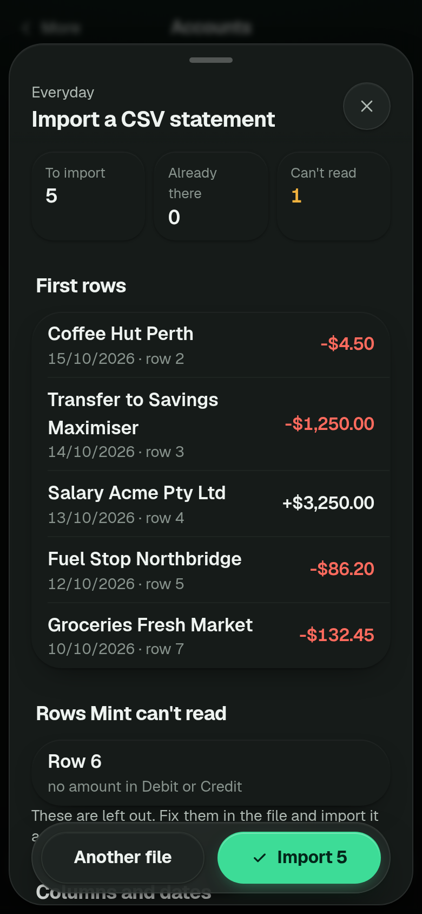

# Using Mint without Redbark: manual accounts and CSV statements

Mint does not need a bank feed. Add an account by hand, export a CSV statement from your bank's website and import it. Leave `REDBARK_API_KEY` unset and nothing else changes: no poll, no nightly job, no Redbark message anywhere in the app. You give up automatic updates, not the budgets, pay cycles, search, tax tags or net worth.

## Five minutes

1. Start Mint ([self-hosting.md](self-hosting.md), or `docker compose --profile real up -d mint`). The first screen on a fresh book offers two choices. Tap **Add an account and import a CSV**.
2. Name the account, say which bank it is at, and give its balance as at the day before your statement starts (the opening balance). Tap **Add account**.
3. Mint opens the import straight away. Choose the CSV file you exported.
4. Check the preview. It lists the first rows with the amount Mint read, how many rows are new, already in Mint, or unreadable (with the row number and the reason), and the columns it picked. Fix anything that is wrong, then tap **Import**.

An import is one undoable step: the toast has an Undo, and the account page lists every import with an Undo.

  

The rows in that picture are invented.

## Getting the file

Every bank puts the export in a slightly different place. Open the account's transaction list on the bank's website (the phone apps often do not offer CSV), look for **Export**, **Download** or **Statements**, choose **CSV**, and pick a date range. Mint reads files up to 2 MB and 20,000 rows, so for a long history export a year at a time.

I could not find a public page from any of CommBank, ANZ, NAB, Westpac, ING or Macquarie that lists the columns of its personal CSV export (checked 2026-11-01), and the third party descriptions I found disagree with each other (one describes the CommBank file as having Debit and Credit columns, others as one signed Amount with no header row). So **none of the layouts below is confirmed by the bank**. Mint does not rely on a bank name. It finds the columns from the header words when there is a header row and from what the cells hold when there is not, and it shows you what it picked before anything is saved.

The layouts Mint is tested against, with invented rows (`test/fixtures/csv/`), are the ones widely reported for each bank:

| Bank | Shape Mint is tested against | Confirmed by the bank |
| --- | --- | --- |
| CommBank | No header row: date, signed amount, description, balance. Also tested: a header row with Debit and Credit columns | No |
| ANZ | No header row: date, signed amount, description. Also tested: Date, Description, Debit, Credit | No |
| NAB | Header row with Date, Amount, Account Number, a blank column, Transaction Type, Transaction Details, Balance, Category, Merchant Name, and dates like `15 Oct 26` | No |
| Westpac | Header row with Bank Account, Date, Narrative, Debit Amount, Credit Amount, Balance, Categories, Serial | No |
| ING | Header row with Date, Description, Credit, Debit, Balance | No |
| Macquarie | Header row with Transaction Date, Details, Account, Category, Subcategory, Debit, Credit, Balance, Original Description, and dates like `15 Oct 2026` | No |

If your file has a different shape, that is what the column step is for (below). If your bank's export is not read correctly and you can share a few invented-or-redacted rows of its layout, open an issue.

## What it understands

- **Delimiters:** comma, semicolon, tab or pipe, found on their own. Quoted fields, doubled quotes and line breaks inside quotes are handled.
- **Header row or none,** and lines of bank preamble above it.
- **Amounts:** one signed Amount column, or separate Debit and Credit (or Paid out and Paid in) columns, where a debit is money out whatever sign the bank gives it. Thousands separators either way round, brackets and a trailing minus as negative, `DR` and `CR`, currency marks.
- **Dates:** `DD/MM/YYYY` first, then `MM/DD/YYYY` and `YYYY-MM-DD`; `15 Oct 26`, `15 October 2026` and `Oct 15, 2026`; a time after the date is dropped. Day-first wins a tie. When every date in the file could be read either way, the preview says so and lets you pick the order.
- **Balance and reference columns,** when there are any. If the statement has a closing balance that differs from Mint's, a switch offers to record the difference as a balance adjustment, in the same undoable import.
- **Text encodings:** UTF-8, falling back to Windows-1252. A formula-looking cell (`=...`) is kept as plain text.
- **Foreign currencies:** the account's currency, with the exchange rate for each day fetched from the ECB (Frankfurter). If a rate cannot be fetched the whole import is refused rather than half done.

## Importing the same rows twice is safe

Each row is matched on the account, the date, the amount and the description (ignoring case and spacing), plus how many times that same row came before it in the file. Importing the same file twice adds nothing, an overlapping statement adds only the new days, and two identical coffees on one day stay two rows.

The limit: if a bank words the same transaction differently in two exports (a pending line that later settles under a new description), Mint sees a new row. Export non-overlapping date ranges, or check the preview's "already in Mint" count, and undo an import that doubled something.

## When Mint cannot place the columns

If it cannot find a date, a description and an amount, the preview says "Pick the date, description and amount columns", shows the first few rows of the file and lists the columns by their header (or Column 1, Column 2 for a file with no header). Choose each one, switch between **One column** and **Out and in columns** for the amount, and set the date order. The preview refreshes as you choose.

The choice is remembered for that account: the next file with the same columns is read the same way and the preview says so. The memory is per account, so a second account with the same layout asks once too.

## Limits

- CSV only. PDF statements, OFX and QIF are not read.
- One account per file. A file that mixes accounts needs splitting first.
- Dates in the future are refused, and rows dated before the account's opening day are kept as history without changing the balance.
- Pending transactions are whatever the bank puts in the file. Mint does not track them.
- There is no automatic update. Import again when you want the new days.
- Mint never moves money, with or without Redbark.

When you want a live feed later, [redbark-setup.md](redbark-setup.md) covers it. Manual accounts keep working beside it.
