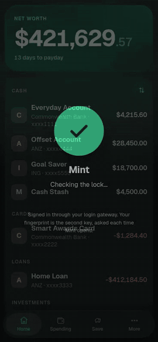
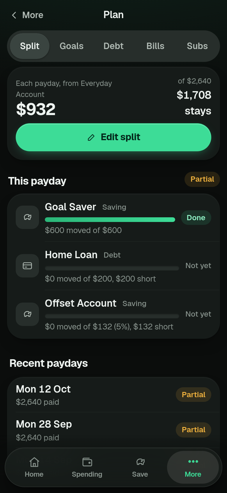
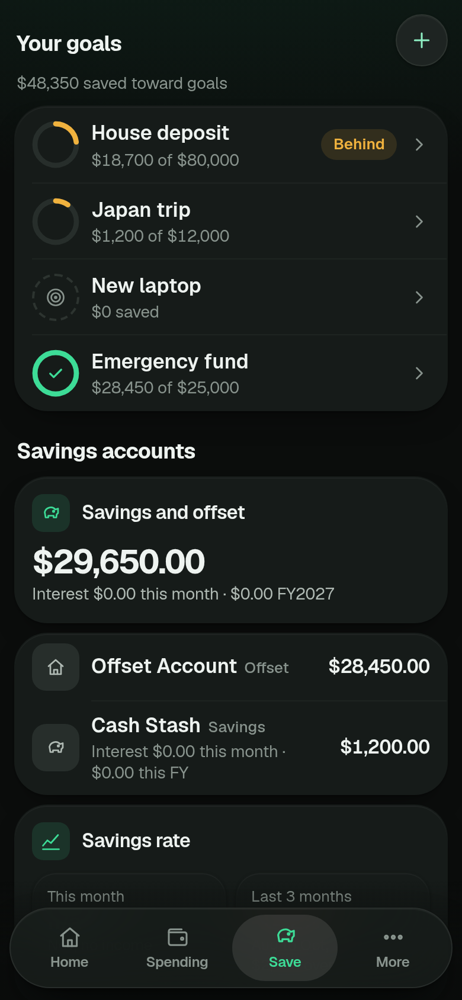
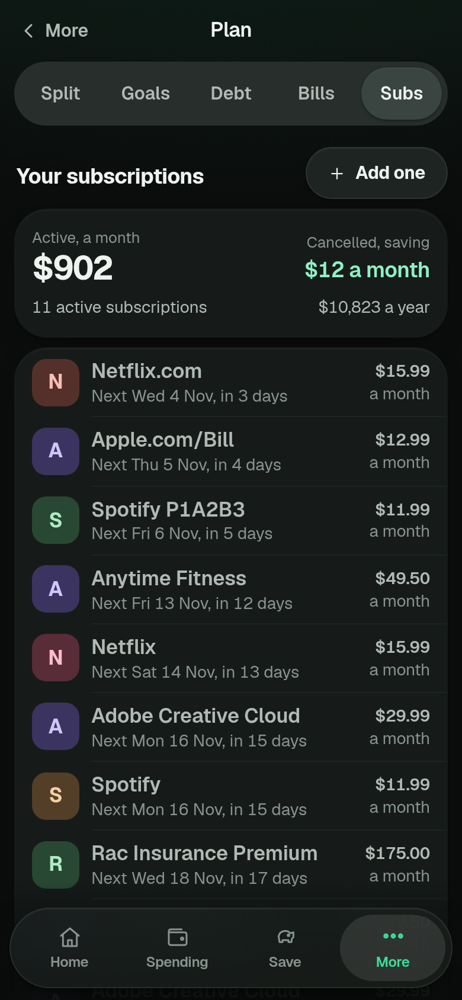
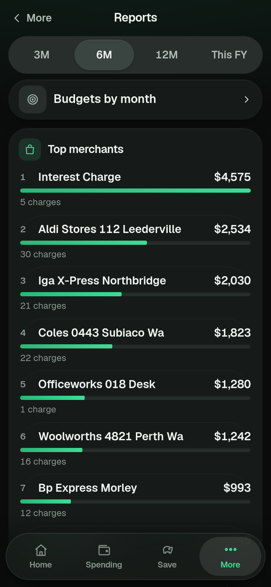
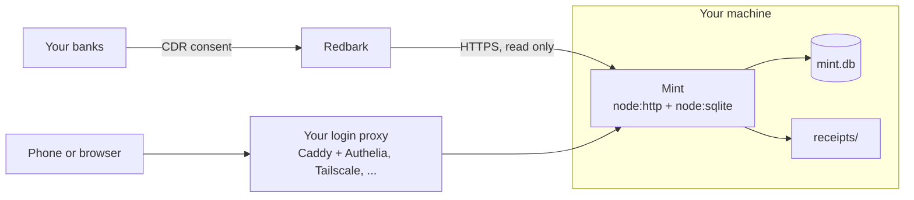

# What Mint does

Every figure and name in these pictures comes from the made-up demo data in `scripts/demo-seed.mjs`. No real account was used.

  

### Money plan

- Pay cycles and per-cycle budgets with rollover, found from your salary deposits, from a bank feed or a CSV statement
- Safe to spend until payday beside every screen on a wide window, and on a phone a Flexible left figure in Budgets and a warning on Home when cash will not cover the bills still due
- A pay split plan (what each payday should send where) and a check that it happened
- Savings goals with a monthly pace, and a view of debt, offset and a home loan

  
  
  
  

### Banks and balances

- Every account Redbark can see, plus accounts it cannot, entered by hand in any currency with CSV statement import (which works on its own, with no Redbark at all)
- Net worth across cash, cards, loans, shares, property and super; live ASX and US share prices
- Transfers between your own accounts are matched so they do not count as spending, and card and loan repayments are recognised
- Wise balances (optional)

### Spending

- Search across everything, saved views, filters, merchant rules and an optional model pass for merchants it cannot place
- Subscriptions and bills detected from the history, with price rise and unusual charge alerts
- A "what changed this pay cycle" digest

### Tax

- ATO deduction tags, business spend, receipt photos, financial year export and an accountant pack
- Income checked against your Notices of Assessment, and a return estimate from the ATO's published tables for the year, with a link to the page each table came from. The tables cover a single resident individual (`lib/taxrates.mjs` lists what is left out). It is general information and bookkeeping, and nothing in it is advice.

### Running it

- A progressive web app: install it to your phone, works offline for reads, queues edits
- A passkey fingerprint lock on top of your own login gateway
- Encrypted off-box backups with a restore test
- An optional Android shell (`android-shell/`) you build and sign yourself

## How it fits together

One Node process serves the API and a plain JavaScript single page app. It polls Redbark every 30 minutes and reconciles nightly. There is no queue, no cache server and no second database.
